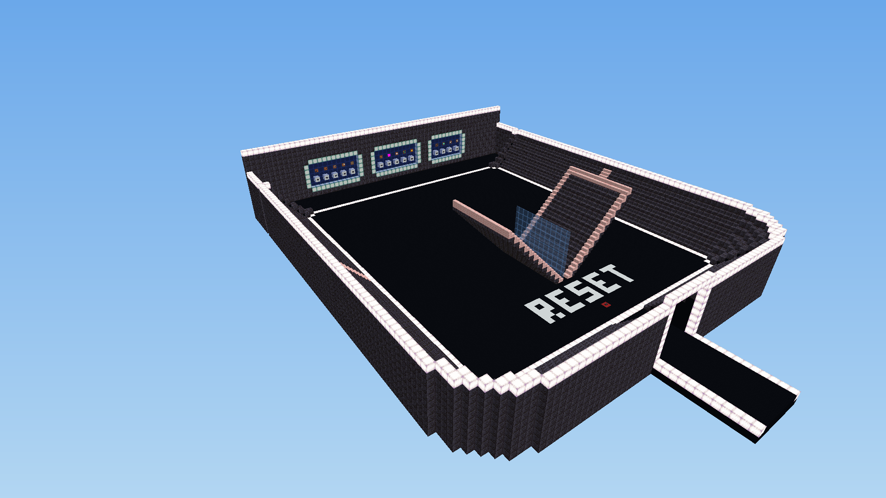
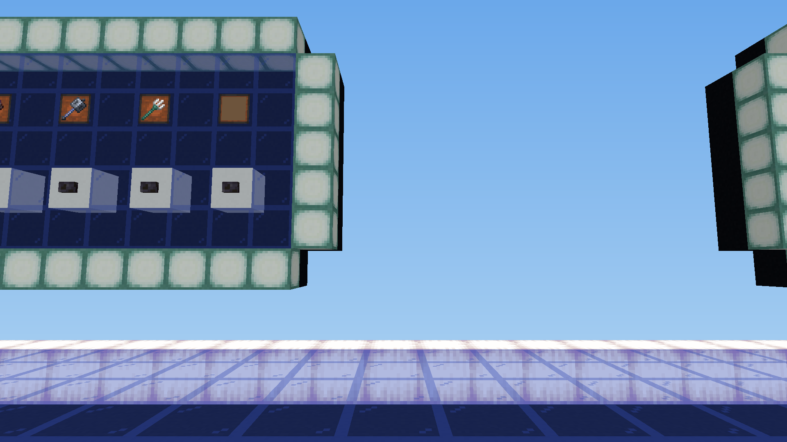

# Rezon 1v1 Build Fight – Minecraft-Version

Nachbau der Fortnite-Map **1v1 Build Fight [Rezon]** (heavyblue, Version 271) für Minecraft Java.

## Download

**[rezon_1v1_arena.litematic herunterladen](https://raw.githubusercontent.com/AlxcBTW/rezon-1v1-minecraft/main/rezon_1v1_arena.litematic)**

[In 3D im Browser ansehen](https://bloxelizer.com/viewer?url=https%3A%2F%2Fraw.githubusercontent.com%2FAlxcBTW%2Frezon-1v1-minecraft%2Fmain%2Frezon_1v1_arena.litematic)

## Ansichtsversion

Diese Version ist zum Anschauen gebaut: nur Blöcke, keine Befehlsblöcke. Die Knöpfe an den Tafeln sind Deko.

Zum Einfügen: Minecraft Java 1.21 oder neuer mit der Mod **Litematica**, Datei in den Ordner `.minecraft/schematics`.

